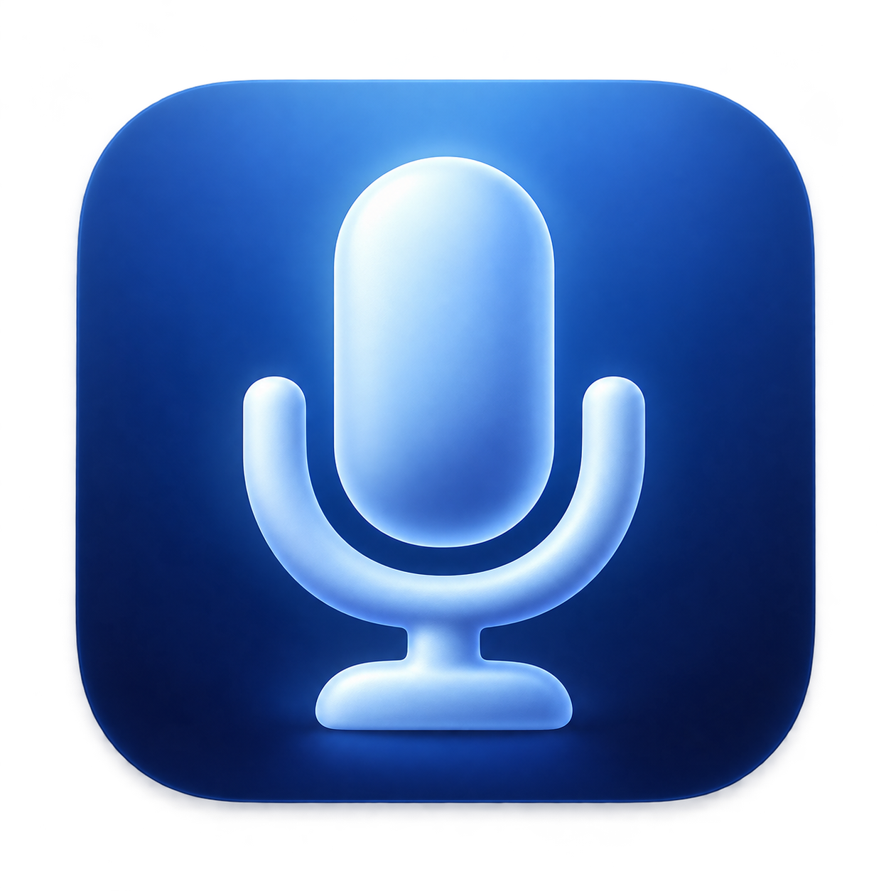
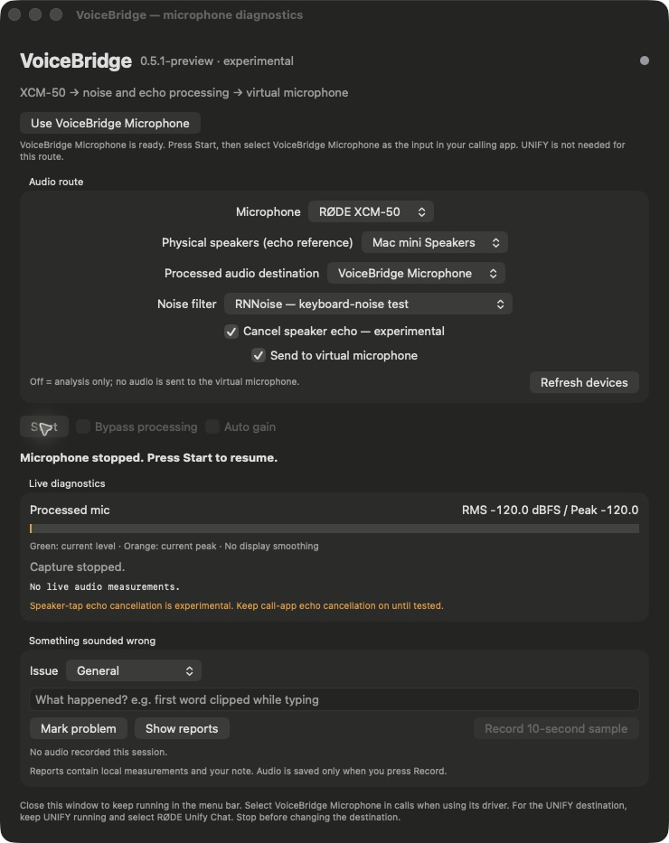
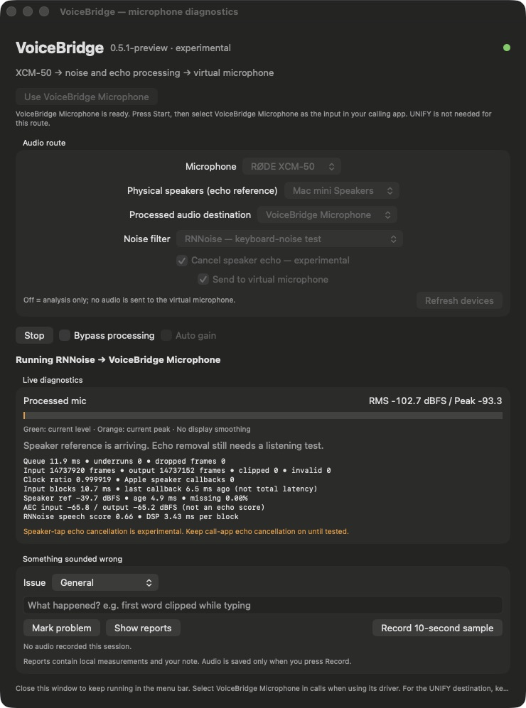
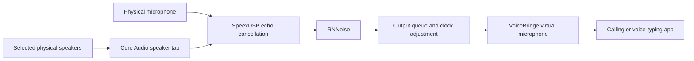

<p align="center"></p>

# VoiceBridge

[](https://github.com/bryantpa/voicebridge/actions/workflows/test.yml)

A small macOS menu-bar app that turns a physical microphone into a processed virtual microphone, with local noise suppression, experimental speaker-echo cancellation, and diagnostics you can use to understand what went wrong.

Built while trying to keep keyboard clicks and speaker audio out of calls with a RØDE XCM-50. The priority is observability: hear a problem, mark it, inspect the measurements, improve the code.

**Experimental preview.** Tested on an Apple Silicon Mac mini with an XCM-50 and the built-in speakers. Broader hardware compatibility and acoustic performance are not yet established. This repository contains source; it is not a signed, notarized consumer release.

> **Try the built-in option first.** macOS includes [Voice Isolation for apps that support Mic Modes](https://support.apple.com/guide/mac-help/mchle82b42f0/mac). It may already solve your problem. VoiceBridge offers an explicit virtual-microphone route and inspectable diagnostics. There is no controlled quality comparison against Apple's filter yet.

## What it does

| Feature | What you get |
| --- | --- |
| Local noise suppression | Xiph's RNNoise runs on the Mac; no account or cloud processing. It reduces noise but does not guarantee removal of typing during speech. |
| Experimental echo cancellation | A Core Audio tap captures the selected physical speaker output as a reference for SpeexDSP. RNNoise alone does not cancel speaker echo. |
| Own virtual microphone | Select **VoiceBridge Microphone** in a calling or voice-typing app. OBS, UNIFY, and BlackHole are not required for this route. |
| Menu-bar operation | Close the diagnostics window and audio keeps flowing. The menu offers start/stop, bypass, diagnostics, and quit. |
| Live measurements | Input/output frames, queue depth, underruns, dropped frames, clipping, clock ratio, DSP time, and speaker-reference health. |
| Problem reports | Add a short note and click **Mark problem** to save the configuration and recent measurements locally. |
| Explicit sample recording | **Record 10-second sample** saves processed microphone audio locally, only when requested. |
| Delay-check helper | Live comparisons and repeatable local routing/processing tests, with timing reports rather than automatic audio recordings. |

## Set it up

### 1. Build the app

Requires macOS **14.4 or later**, Xcode Command Line Tools with **Swift 6 or later**, and Python 3. The build uses macOS tools including `clang`, `sips`, `iconutil`, `codesign`, and `pkgbuild`. Apple Silicon is the tested architecture.

```sh
git clone https://github.com/bryantpa/voicebridge.git
cd voicebridge
bash build.sh
```

This creates `VoiceBridge.app` and bundles the virtual-microphone installer. Building does not install the driver or change your audio settings. RNNoise, its model, and the required SpeexDSP sources are vendored, so the build does not fetch dependencies. The RNNoise model accounts for most of the source size.

Copy `VoiceBridge.app` to Applications using Finder, then open it. If replacing an existing copy, quit that copy first. The local build is ad-hoc signed; rebuilding can cause macOS to request permissions again.

### 2. Install the virtual microphone

In VoiceBridge, click **Set up VoiceBridge Microphone…** and finish the macOS installer. Administrator authorization is required because it installs a Core Audio HAL plug-in at:

```text
/Library/Audio/Plug-Ins/HAL/VoiceBridgeMic.driver
```

**Installation briefly restarts system audio. Finish calls first.** VoiceBridge watches for the device to appear and selects it when ready. If installation succeeds but the device does not appear, restart the Mac and open VoiceBridge again.

### 3. Choose the route and start

| Control | Selection |
| --- | --- |
| Microphone | Your physical microphone; tested with **RØDE XCM-50** |
| Physical speakers (echo reference) | The actual device playing your call audio; tested with **Mac mini Speakers** |
| Processed audio destination | **VoiceBridge Microphone** |
| Noise filter | **RNNoise — keyboard-noise test** |
| Cancel speaker echo | Optional experimental processing when using speakers |
| Send to virtual microphone | **On** |

Press **Start**. Allow microphone access and, for the speaker tap, system-audio capture if macOS asks. If access was denied, review VoiceBridge in System Settings → Privacy & Security. Stop processing before changing route selections.

The screenshot below shows the configured route after the driver is installed, before pressing Start.



### 4. Select it in your calling app

Set the calling or voice-typing app's **input** to **VoiceBridge Microphone**. Keep its **output** on your physical speakers or headphones. You can also choose VoiceBridge Microphone under System Settings → Sound → Input, but apps with their own saved input selection may need to be changed separately.

Selecting the physical RØDE microphone directly bypasses VoiceBridge. Selecting an old **RØDE Unify Chat** input still depends on UNIFY's routing.

For an initial comparison, avoid stacking multiple noise suppressors: use Standard macOS Mic Mode for the relevant app and disable extra call-app noise suppression where possible. Keep the call app's echo cancellation enabled until speaker use has been tested. Listen to the result; different apps may process the signal differently.

### 5. Leave it running

Closing the window keeps VoiceBridge in the menu bar. **Stopping or quitting VoiceBridge stops the processed microphone feed**, even though the virtual device remains listed. After reopening the app, waking the Mac, or reconnecting an audio device, check the status and press Start if needed. Automatic launch and automatic recovery are not implemented yet.

## When something sounds wrong

1. Open **Show Diagnostics…** from the menu-bar icon.
2. Choose an issue, write what happened, and click **Mark problem**. For example: “The first word disappeared after I stopped typing.”
3. If a listening sample would help, deliberately record a ten-second sample. Compare with **Bypass processing** using similar speech and background noise.
4. Open **Show reports** and review the files before sharing anything.

**Running RNNoise → VoiceBridge Microphone** confirms the selected route. Route controls are disabled while running; the meters and counters help check that audio is moving.



A low meter is not itself an error: RNNoise can suppress a quiet room almost completely. Look for moving input/output frame counters and check the selected input in the receiving app. Increasing underruns or dropped frames suggests buffering trouble. A missing speaker reference means echo cancellation may be bypassing; a healthy reference only proves data is arriving, not that echo is removed well.

Reports live under `~/Library/Application Support/VoiceBridge/Reports`. Automatic logs rotate at 8 MB, retaining the current file and one previous file per session. On startup, rotation, and hourly while logging, automatic logs from older sessions are removed after seven days or oldest-first to bring automatic log storage under a 64 MB budget. Empty session folders are removed. Marked problem reports (including up to 180 recent events) and explicitly recorded CAF samples are preserved until you delete them; they are outside this budget.

**Privacy:** VoiceBridge has no upload or telemetry service. Live audio is processed in memory. Speaker-reference audio is not saved. Microphone audio is saved only through explicit sample recording. Reports can contain device names/UIDs, local file paths, timestamps, and your notes; they are not anonymized. Recordings, reports, local fixtures, and compiled apps are excluded from this repository.

## How it works



Echo cancellation is optional. The driver presents a 48 kHz stereo loopback device; the app duplicates its processed mono signal into both channels. A separate experimental Apple VoiceProcessingIO backend is retained for development; it is not the same control as macOS's menu-bar Voice Isolation mode.

| Directory | Purpose |
| --- | --- |
| `Sources/VoiceBridge` | SwiftUI diagnostics, menu bar, permissions, device selection, and local reports |
| `Sources/AudioCore` | Core Audio capture/output, queues, RNNoise integration, speaker tap, and echo processing |
| `Sources/RNNoise`, `Sources/SpeexDSP` | Vendored upstream DSP code and licenses |
| `VirtualMic` | HAL driver, timestamped loopback transport, installer, and driver tests |
| `LatencyCheck` | Local timing harness and correlation analysis |
| `Tests` | Audio-core and processing self-tests |

## Tests and measured delay

```sh
bash test.sh
bash VirtualMic/test.sh
bash LatencyCheck/build.sh
```

The first two run C tests with AddressSanitizer and UndefinedBehaviorSanitizer. Building the delay helper also runs its synthetic correlation self-tests. These tests do not require installing a driver or changing the live microphone route.

Early local measurements on the development Mac:

| Route | Observed delay |
| --- | --- |
| UNIFY routing alone | 118 ms |
| VoiceBridge virtual driver alone | 10 / 10 / 10 ms |
| Full VoiceBridge processing → UNIFY | 218 / 218 / 218 ms |
| Full VoiceBridge processing → own virtual driver | 104 / 104 / 102 ms |

These are **local timestamp/correlation estimates**, not mouth-to-remote-listener latency. The injected-speech processing tests exclude acoustic/ADC delay, calling-app processing, network transport, and remote playback. The full-processing tests used a 10 ms output reserve. Driver timestamps have not been independently calibrated, and 2 ms analysis bins do not imply 2 ms absolute accuracy. This is a small development sample, not a cross-device benchmark or a comparison of noise-filter quality.

See [Testing and measurement](docs/testing.md) for the automatic loop, fixture handling, and limitations.

## Current limits

- This is a personal prototype, with limited hardware coverage and no long-duration reliability qualification.
- Speech quality and speaker-echo performance still require listening tests, especially while both people speak.
- Idle speaker hardware can stop supplying reference samples. The app exposes missing-reference counters and skips echo processing for missing samples.
- With the RNNoise filter, the microphone must run at 48 kHz, and so must the speakers when echo cancellation is on. VoiceBridge checks before starting; change the rate in Audio MIDI Setup.
- When sending to the original RØDE UNIFY route, the app refuses to send while OBS is running, and stops if OBS opens, to prevent duplicate microphone feeds. This does not apply to VoiceBridge Microphone.
- Sleep and device changes stop capture; manual restart is required.
- The virtual microphone is installed system-wide. Quit VoiceBridge before replacing the driver, and do not install during calls.

To remove the driver, quit VoiceBridge, move **only** `VoiceBridgeMic.driver` out of `/Library/Audio/Plug-Ins/HAL` using Finder with administrator authorization, and restart the Mac. Remove VoiceBridge from Applications if desired. Removing the app alone leaves the driver installed. Reports remain in Application Support until you remove them.

## Credits and licensing

VoiceBridge combines a custom app and transport with established DSP implementations; it does not train its own RNNoise model.

- [RNNoise](https://github.com/xiph/rnnoise): [license](Sources/RNNoise/COPYING), [pinned source/model provenance](Sources/RNNoise/PROVENANCE.txt).
- [SpeexDSP](https://github.com/xiph/speexdsp): [license](Sources/SpeexDSP/COPYING), [pinned provenance](Sources/SpeexDSP/PROVENANCE.txt).
- Apple's audio-server-driver sample supplies the driver scaffolding: [MIT notice](VirtualMic/APPLE-LICENSE.txt), [source and modifications](VirtualMic/PROVENANCE.txt).
- The app icon was AI-generated; its [source prompt](Assets/ICON-PROMPT.txt) is included.

The original VoiceBridge code is released under the [MIT License](LICENSE). Third-party license terms remain with their respective files.
